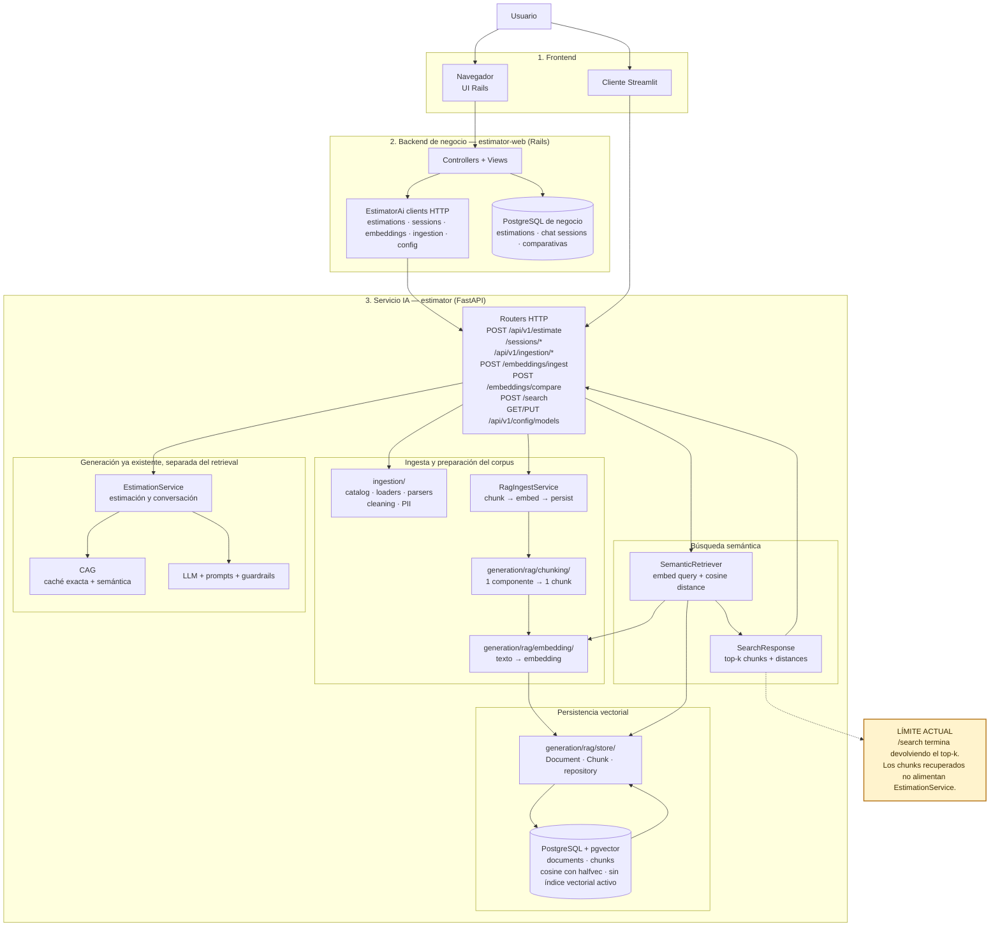
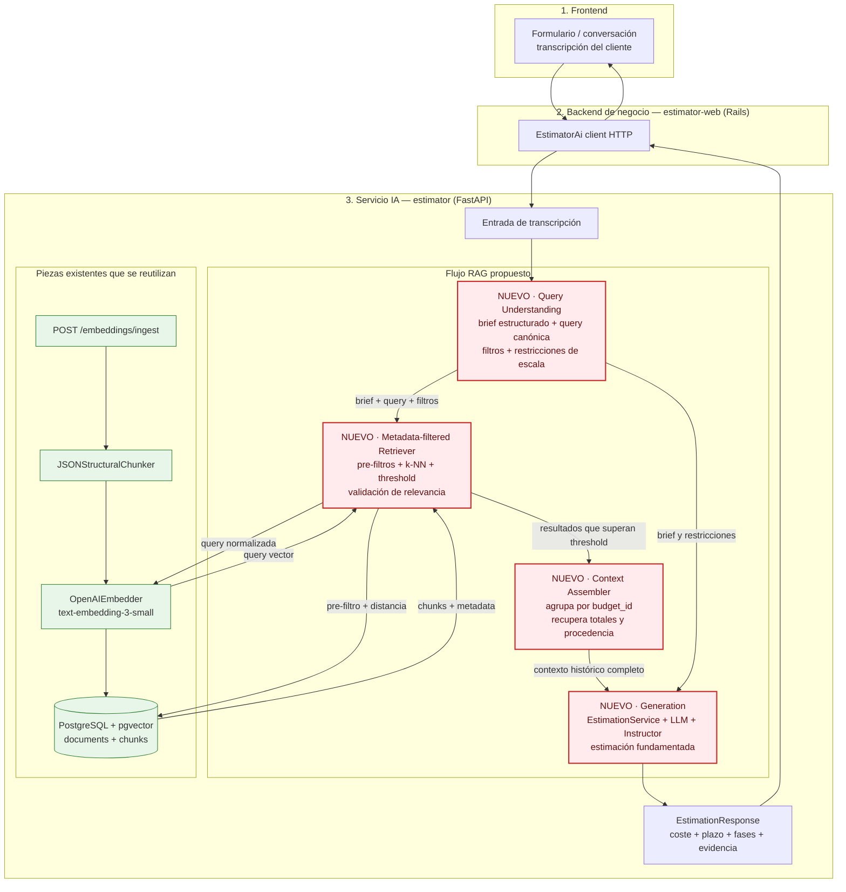

# Diagnóstico arquitectónico — Sesión 09 (pre-work)

## 1. Diagrama de la arquitectura actual



El sistema tiene dos recorridos que aún permanecen separados. El recorrido RAG puede ingerir
presupuestos, fragmentarlos, generar embeddings, persistirlos en pgvector y recuperar los `k`
chunks más próximos a una consulta. Por otra parte, `EstimationService` ya genera estimaciones
mediante prompts, LLM, guardrails y CAG. Sin embargo, el resultado de `POST /search` sale como una
respuesta HTTP independiente: los chunks recuperados no se incorporan al flujo de estimación.
Por ello, ante una transcripción, el sistema actual puede encontrar antecedentes parecidos, pero
no puede producir una estimación fundamentada en esos antecedentes.

---

## 2. Trace anotado de `02_ambiguous.txt`

El trace usa la transcripción completa de Casa Castaño (2.854 caracteres). El cliente quiere
vender productos gourmet online, incorporar alguna forma de fidelización, consultar pedidos y
stock desde un panel y aceptar pagos con tarjeta. El corpus contiene 17 presupuestos históricos
divididos en 60 chunks.

### Paso 1 — Embeber la transcripción completa

No existe un endpoint que exponga el vector crudo. Se invoca directamente el mismo módulo y modelo
que utiliza internamente `POST /search`:

```bash
cd /Users/tournemonde/Documents/01.Projects/ai-engineering/estimator

uv run python - <<'PY'
from pathlib import Path

from app.dependencies import get_embedder

text = Path("../examples/transcripts/02_ambiguous.txt").read_text(encoding="utf-8")
embedder = get_embedder()

if embedder is None:
    raise RuntimeError("OPENAI_API_KEY is not configured")

vector = embedder.embed_one(text)
norm = sum(component**2 for component in vector) ** 0.5

print(f"characters={len(text)}")
print(f"dimension={len(vector)}")
print(f"first_component={vector[0]}")
print(f"last_component={vector[-1]}")
print(f"norm={norm:.6f}")
PY
```

Respuesta obtenida:

```text
characters=2854
dimension=1536
first_component=0.00623321533203125
last_component=0.019012451171875
norm=0.999691
```

> **Comentario.** Un único vector de 1.536 dimensiones representa toda la conversación: mezcla
> requisitos relevantes —venta online, fidelización, panel, pagos y correo— con divagaciones y
> ruido conversacional. Representa mejor el conjunto de temas tratados que una especificación
> precisa de lo que debe construirse. La norma cercana a 1 indica que el embedding está
> prácticamente normalizado.

### Paso 2 — Búsqueda semántica (top-5)

Se envía la transcripción completa a `POST /search`. El endpoint la vuelve a embeber con el mismo
modelo y ordena los chunks por distancia coseno ascendente:

```bash
cd /Users/tournemonde/Documents/01.Projects/ai-engineering

jq -n --rawfile query examples/transcripts/02_ambiguous.txt \
  '{query: $query, k: 5}' \
  | curl -sS -X POST http://localhost:8000/search \
      -H 'Content-Type: application/json' \
      -d @- \
  | tee /tmp/session9-search-response.json \
  | jq
```

Respuesta obtenida (el campo `query`, que reproduce literalmente los 2.854 caracteres de la
transcripción, se abrevia para no duplicarla; los resultados se conservan completos):

```json
{
  "query": "<contenido completo de examples/transcripts/02_ambiguous.txt>",
  "k": 5,
  "search_time_ms": 340,
  "results": [
    {
      "chunk_id": 16,
      "document_id": 5,
      "chunk_type": "budget_component",
      "content": "[Project: Headless e-commerce storefront with personalized recommendations]\n[Client sector: ecommerce | Year: 2024 | Main tech: node]\n\nComponent: Product catalog API\nDescription: GraphQL catalog API with faceted search, inventory availability and multi-currency pricing backed by Elasticsearch.\nTech stack: node, graphql, elasticsearch\nComplexity: medium\nEstimated hours: 150",
      "distance": 0.6082955228166176,
      "metadata": {
        "year": 2024,
        "budget_id": "BUD-2024-005",
        "complexity": "medium",
        "component_id": "CATALOG-001",
        "client_sector": "ecommerce",
        "estimated_hours": 150,
        "main_technology": "node"
      }
    },
    {
      "chunk_id": 17,
      "document_id": 5,
      "chunk_type": "budget_component",
      "content": "[Project: Headless e-commerce storefront with personalized recommendations]\n[Client sector: ecommerce | Year: 2024 | Main tech: node]\n\nComponent: Cart and checkout service\nDescription: Stateless cart service with promotion engine, tax calculation and a checkout orchestration that integrates the payment provider.\nTech stack: node, redis, postgresql\nComplexity: high\nEstimated hours: 140",
      "distance": 0.6138128623757041,
      "metadata": {
        "year": 2024,
        "budget_id": "BUD-2024-005",
        "complexity": "high",
        "component_id": "CART-002",
        "client_sector": "ecommerce",
        "estimated_hours": 140,
        "main_technology": "node"
      }
    },
    {
      "chunk_id": 18,
      "document_id": 5,
      "chunk_type": "budget_component",
      "content": "[Project: Headless e-commerce storefront with personalized recommendations]\n[Client sector: ecommerce | Year: 2024 | Main tech: node]\n\nComponent: Personalized recommendations\nDescription: Collaborative-filtering recommendations served from a feature store and exposed as a low-latency API for product and cart pages.\nTech stack: node, redis\nComplexity: medium\nEstimated hours: 110",
      "distance": 0.637239193021222,
      "metadata": {
        "year": 2024,
        "budget_id": "BUD-2024-005",
        "complexity": "medium",
        "component_id": "RECO-003",
        "client_sector": "ecommerce",
        "estimated_hours": 110,
        "main_technology": "node"
      }
    },
    {
      "chunk_id": 19,
      "document_id": 5,
      "chunk_type": "budget_component",
      "content": "[Project: Headless e-commerce storefront with personalized recommendations]\n[Client sector: ecommerce | Year: 2024 | Main tech: node]\n\nComponent: Storefront PWA\nDescription: Progressive web app storefront consuming the headless APIs with server-side rendering for SEO.\nTech stack: next_js, react\nComplexity: low\nEstimated hours: 60",
      "distance": 0.6387455049929066,
      "metadata": {
        "year": 2024,
        "budget_id": "BUD-2024-005",
        "complexity": "low",
        "component_id": "STORE-004",
        "client_sector": "ecommerce",
        "estimated_hours": 60,
        "main_technology": "node"
      }
    },
    {
      "chunk_id": 27,
      "document_id": 8,
      "chunk_type": "budget_component",
      "content": "[Project: Fashion returns management and resale portal]\n[Client sector: ecommerce | Year: 2023 | Main tech: dotnet]\n\nComponent: Returns portal\nDescription: Self-service returns portal with label generation, reason capture and automatic restock or resale routing.\nTech stack: dotnet, sqlserver\nComplexity: medium\nEstimated hours: 140",
      "distance": 0.6443924123988022,
      "metadata": {
        "year": 2023,
        "budget_id": "BUD-2024-008",
        "complexity": "medium",
        "component_id": "RET-001",
        "client_sector": "ecommerce",
        "estimated_hours": 140,
        "main_technology": "dotnet"
      }
    }
  ]
}
```

> **Comentario.** Los cinco resultados pertenecen al sector `ecommerce`, pero cuatro proceden del
> mismo presupuesto. Las distancias están comprimidas entre 0,6083 y 0,6444: el sistema encuentra
> una temática común, aunque no muestra una separación fuerte entre resultados y devuelve cinco
> elementos incluso cuando el último es poco relevante.

### Paso 3 — Lectura de los chunks devueltos

| # | Componente | Presupuesto / sector | Distancia | Valoración |
|---|---|---|---:|---|
| 1 | `CATALOG-001` — Product catalog API | `BUD-2024-005` / ecommerce | 0,6083 | **Relevante, pero parcial.** Casa Castaño necesita mostrar productos, stock y precios. GraphQL, Elasticsearch y multimoneda parecen sobredimensionados para una tienda pequeña. |
| 2 | `CART-002` — Cart and checkout service | `BUD-2024-005` / ecommerce | 0,6138 | **Muy relevante.** El carrito, el checkout y el pago seguro aparecen explícitamente en la transcripción. El motor de promociones e impuestos podría superar el alcance inicial. |
| 3 | `RECO-003` — Personalized recommendations | `BUD-2024-005` / ecommerce | 0,6372 | **Parcialmente relevante.** Puede fomentar ventas, pero no equivale al programa de puntos o club de fidelización pedido. El sistema aproxima dos conceptos relacionados pero distintos. |
| 4 | `STORE-004` — Storefront PWA | `BUD-2024-005` / ecommerce | 0,6387 | **Muy relevante.** El storefront es la tienda online que utilizarán los clientes. PWA, React y SSR son decisiones técnicas potencialmente excesivas para este alcance inicial. |
| 5 | `RET-001` — Returns portal | `BUD-2024-008` / ecommerce | 0,6444 | **Irrelevante / falso positivo.** `Returns` se refiere a devoluciones de producto, no a clientes recurrentes ni fidelización. La transcripción no solicita gestión de devoluciones o reventa. |

> **Comentario.** El top-5 recupera correctamente varias capacidades de comercio electrónico,
> pero también mezcla intención funcional con soluciones más complejas de lo necesario. La ausencia
> de umbral obliga a incluir el portal de devoluciones aunque no responda a ninguna necesidad
> expresada por el cliente.

---

## 3. Diagnóstico: cinco fallos identificados

> Cinco fallos concretos y verificables que impiden hoy convertir la transcripción en una
> estimación de calidad. Para cada uno: Problema observado / Causa probable / Propuesta de solución.

### Fallo 1 — La transcripción completa se usa como si fuera una query
- **Problema observado:** un único embedding mezcla los requisitos útiles (tienda online,
  fidelización, panel, pagos y correo) con conversación irrelevante (la historia de la tienda, el
  primo en Francia o las dudas del cliente). Las cinco distancias quedan en una banda estrecha,
  entre 0,6083 y 0,6444, sin un match claramente dominante.
- **Causa probable:** no existe una etapa entre la transcripción y `embed_one`; el pipeline asume
  que la entrada ya es una consulta limpia y representativa de una única intención.
- **Propuesta de solución:** añadir una etapa de comprensión de query que extraiga un brief
  estructurado con objetivo, funcionalidades, restricciones y alcance antes de buscar.

### Fallo 2 — Desajuste de idioma y registro entre query y corpus
- **Problema observado:** la transcripción está escrita en español conversacional ("algo de
  puntos", "un panel con el café"), mientras que los chunks están en inglés técnico ("faceted
  search", "checkout orchestration", "feature store"). El modelo recupera correctamente la
  temática `ecommerce`, pero las distancias siguen siendo altas y próximas entre sí.
- **Causa probable:** query y corpus se embeben sin normalizar idioma, terminología ni nivel de
  abstracción. El embedding multilingüe reduce el problema, pero no garantiza que la intención
  informal se alinee con una especificación técnica.
- **Propuesta de solución:** reformular el brief como una spec canónica, en el mismo idioma y
  registro técnico que el corpus, antes de generar el embedding de búsqueda.

### Fallo 3 — La búsqueda no aplica filtros por metadata
- **Problema observado:** los resultados de este trace pertenecen a `ecommerce`, pero esto no está
  garantizado por la consulta: `/search` no recibe filtros y el ranking ignora campos ya
  persistidos como `client_sector`, `complexity` o `main_technology`. El portal de devoluciones
  entra por similitud global aunque su funcionalidad no haya sido solicitada.
- **Causa probable:** `ChunkStore.search` ordena todo el corpus por distancia vectorial sin una
  cláusula `WHERE` ni una etapa de filtrado o reranking basada en el brief.
- **Propuesta de solución:** inferir metadata útil desde el brief y aplicar pre-filtros por sector,
  tipo de proyecto o restricciones de alcance antes del k-NN, complementados con validación de
  relevancia funcional.

### Fallo 4 — El retrieval no está conectado a la generación
- **Problema observado:** la última salida del flujo es una lista de chunks con metadata y
  distancias. El sistema no responde a la petición final de Rubén: obtener una propuesta con coste
  y plazo fundamentada en presupuestos históricos.
- **Causa probable:** no existe wiring de augmentation y generation; los chunks recuperados no se
  ensamblan como contexto ni llegan al `EstimationService`.
- **Propuesta de solución:** añadir una etapa que construya contexto con los antecedentes
  recuperados y lo entregue al LLM para producir un `EstimationResult` validado y trazable.

### Fallo 5 — La granularidad del chunk pierde el presupuesto padre
- **Problema observado:** cada resultado contiene un componente y sus horas (por ejemplo,
  `CART-002`, 140 horas), pero no el coste, plazo, total de horas ni composición completa del
  presupuesto histórico. Es insuficiente para fundamentar una estimación de proyecto.
- **Causa probable:** el chunker crea un chunk por componente, lo que mejora la precisión del
  retrieval, pero no existe una etapa posterior que reconstruya el nivel de documento padre.
- **Propuesta de solución:** incorporar un ensamblador de contexto que agrupe los hits por
  `budget_id`, recupere los totales y componentes relacionados y aporte esa vista completa a la
  generación.

### Fallo 6 — Top-k fijo sin umbral de relevancia
- **Problema observado:** `/search` devuelve siempre cinco resultados; `RET-001` (portal de
  devoluciones) entra con distancia 0,6444 aunque no responde a ninguna necesidad expresada.
- **Causa probable:** el contrato solo acepta `k`; no existe threshold calibrado ni decisión de
  "no hay más resultados suficientemente relevantes".
- **Propuesta de solución:** calibrar un umbral con un conjunto de evaluación y devolver menos de
  `k` resultados cuando los candidatos restantes no lo superen.

### Fallo 7 — Soluciones recuperadas sobredimensionadas para el cliente
- **Problema observado:** para una tienda pequeña que pide empezar sin complicarse aparecen
  GraphQL, Elasticsearch, arquitectura headless, feature store, recomendaciones colaborativas,
  PWA y SSR. La funcionalidad general encaja, pero la solución técnica y sus horas pueden inflar
  la estimación.
- **Causa probable:** la similitud semántica identifica el dominio y las funcionalidades, pero no
  modela bien tamaño de empresa, madurez tecnológica, presupuesto o complejidad aceptable.
- **Propuesta de solución:** incluir escala y restricciones en el brief estructurado y utilizarlas
  en filtros o reranking para priorizar antecedentes comparables, no solo semánticamente próximos.

### Mapping con el ejercicio resuelto del curso

| Nuestro diagnóstico | Correspondencia en el ejercicio resuelto | Relación |
|---|---|---|
| Fallo 1 — Transcripción completa como query | Fallo 1 — La transcripción no es una query | Coincidencia directa, con nuestras distancias reales. |
| Fallo 2 — Idioma y registro | Fallo 2 — Desajuste de idioma y registro | Coincidencia directa; nuestro trace recupera bien el sector, por lo que se describe como degradación y no como fallo absoluto. |
| Fallo 3 — Sin filtros por metadata | Fallo 3 — Recuperación sin filtrado por metadata | Coincidencia arquitectónica. En nuestro trace no mezcla sectores, pero verificamos que el código no aplica ningún filtro. |
| Fallo 4 — Retrieval sin generación | Fallo 4 — No existe etapa de generación | Coincidencia directa. |
| Fallo 5 — Se pierde el presupuesto padre | Fallo 5 — El chunk pierde el rollup de coste/horas | Coincidencia directa. |
| Fallo 6 — Top-k sin threshold | “Otros”: `k=5` fijo sin umbral | El curso lo considera secundario; nuestro trace lo evidencia con `RET-001`. |
| Fallo 7 — Soluciones sobredimensionadas | Comentarios de relevancia + parcialmente Fallos 1 y 3 | Aportación explícita de nuestro trace; el ejercicio resuelto la señala en la lectura de chunks, pero no la separa como fallo propio. |

---

## 4. Propuesta de evolución arquitectónica



**Responsabilidad y flujo.** *Query Understanding* transforma la transcripción en un brief,
una query técnica y restricciones de escala; con ello corrige ruido, idioma y sobredimensionamiento.
El *Metadata-filtered Retriever* aplica filtros, similitud y threshold para devolver solo chunks
relevantes. El *Context Assembler* los agrupa por `budget_id` y recupera totales y procedencia del
presupuesto padre. *Generation* combina brief y contexto dentro de `EstimationService` para producir
un `EstimationResult` validado y fundamentado. La pieza más crítica es *Query Understanding*: si el
brief representa mal la necesidad, filtros, retrieval, contexto y generación parten de una premisa
incorrecta.
